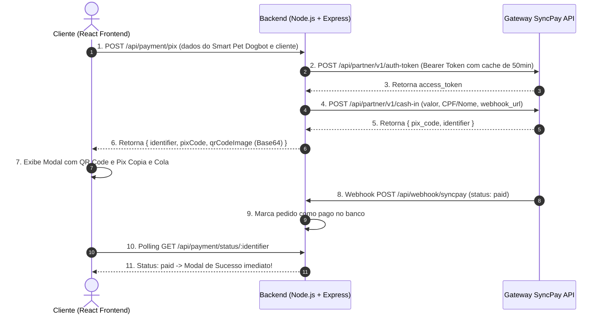

# Manual de Integração: SyncPay (Sync Payments) + Node.js + React

Este documento detalha o fluxo de arquitetura, segurança, painel de feedbacks verificados e execução via `npm run dev` da aplicação **Cachorro Robô Inteligente Smart Pet Dogbot Cachorro Colorido** integrada com a API da **Sync Payments** (Pix Cash-in e Webhooks).

---

## 1. Visão Geral da Arquitetura (Full-Stack React + Node.js)

O projeto utiliza **React 18 (Vite HMR)** integrado diretamente ao **Servidor Node.js (Express)** na porta `3000`. Com um único comando (`npm run dev`), tanto o Frontend React quanto a API Backend da SyncPay são executados simultaneamente.



---

## 2. Estrutura de Componentes React & Feedbacks

* **[`src/components/ProductOffer.jsx`](file:///c:/Users/Pichau/Desktop/Ofertas/src/components/ProductOffer.jsx)**:
  * **Campanha Especial de Natal (R$ 99,90 - 67% OFF)**: Banner natalino, gatilho de entrega garantida antes do Natal, destaque para a caixa original pronta para presentear e parcelamento em até 12x de R$ 9,90.
  * Galeria interativa com as 5 fotos oficiais da pasta `/img` (incluindo a foto real na caixa `img/foto-real-cliente-dogbot.jpg`).
  * Simulador de Frete por CEP com feedback visual instantâneo.
  * Barra de escassez, cronômetro regressivo, especificações técnicas (`31 cm × 16 cm × 19,5 cm`) e aviso legal (*Recomendado a partir dos 3 anos*).
* **[`src/components/CustomerFeedbacks.jsx`](file:///c:/Users/Pichau/Desktop/Ofertas/src/components/CustomerFeedbacks.jsx)**:
  * Painel de nota geral (`4.9 / 5.0`), barras de distribuição de estrelas e métricas por categoria (*Qualidade, Comandos de Voz/App, Bateria USB-C e Diversão*).
  * Filtros dinâmicos de avaliações (`Todos`, `Com Fotos`, `Programação & App`, `Entrega Rápida`).
  * Botão interativo `"Útil 👍"` em cada avaliação, Lightbox de fotos de clientes e formulário `"✍️ Deixar Meu Feedback"` com publicação em tempo real.
* **[`index.html`](file:///c:/Users/Pichau/Desktop/Ofertas/index.html)**:
  * Landing page principal do projeto, contendo a estrutura semântica HTML5 completa, galeria com fotos reais (`img/foto-real-cliente-dogbot.jpg`), formulário com dados e endereço completo (com busca automática de CEP via ViaCEP), aviso pré-pagamento, QR Code PIX no valor de **R$ 99,90** e a tela oficial da Central de Rastreio com prazo de entrega de **7 a 14 dias úteis**.
* **[`src/components/PixModal.jsx`](file:///c:/Users/Pichau/Desktop/Ofertas/src/components/PixModal.jsx)**:
  * **Formulário Completo de Destinatário & Endereço de Entrega**: Coleta Nome, CPF, E-mail, WhatsApp e Endereço completo (CEP com preenchimento automático via ViaCEP, Rua/Avenida, Número, Complemento, Bairro, Cidade e UF).
  * **Aviso Pré-Pagamento Claro**: Informa antes e durante o QR Code PIX que a página exclusiva com o Código de Rastreio abrirá automaticamente assim que o PIX for pago.
* **[`src/components/OrderTrackingPage.jsx`](file:///c:/Users/Pichau/Desktop/Ofertas/src/components/OrderTrackingPage.jsx)**:
  * **Página Exclusiva de Rastreamento Pós-Pagamento**: Abre automaticamente assim que o status do PIX muda para `paid`, exibindo o **Código de Rastreio Oficial** (ex: `XP849201745BR`), botão de copiar código, linha do tempo da remessa com previsão de **7 a 14 dias úteis**, endereço de entrega confirmado e botão de impressão de comprovante.

---

## 3. O Preço do Pix de R$ 99,90 e o Painel do SyncPay

> ### 💡 O valor do Pix já está certo? Preciso mudar algo no painel da SyncPay?
> **O valor de R$ 99,90 já está 100% configurado e exato no código! Você NÃO precisa criar produtos nem alterar valores dentro do painel da SyncPay.**
>
> **Por que?**
> A SyncPay é um gateway bancário direto via API REST (`Cash-in`). Diferente de plataformas com vitrine (como Hotmart ou Kiwify), a SyncPay **não possui catálogo de produtos** no painel dela.
> Quando o cliente clica para pagar, o nosso backend Node.js (`server/server.js`) envia automaticamente para o endpoint `/api/partner/v1/cash-in`:
> ```json
> {
>   "amount": 99.90,
>   "description": "Smart Pet Dogbot - Campanha de Natal",
>   "client": { "name": "...", "cpf": "..." }
> }
> ```
> O QR Code e a chave Copia e Cola gerados no banco já vêm travados no valor exato de **R$ 99,90**.
> 
> **A única coisa necessária no painel da SyncPay:**
> 1. Ter suas chaves de API ativas (`SYNCPAY_CLIENT_ID` e `SYNCPAY_CLIENT_SECRET`), que já estão configuradas no `.env` e foram testadas com sucesso.
> 2. Se for colocar em produção na sua VPS/Hospedagem, cadastrar o IP do seu servidor caso sua conta tenha restrição de IP, e apontar a URL de Webhook para o seu domínio público (`https://seudominio.com/api/webhook/syncpay`).

---

## 4. Como Executar com `npm run dev`

Na pasta raiz do projeto (`c:\Users\Pichau\Desktop\Ofertas`), basta rodar:

```bash
npm install
npm run dev
```

> **Dica (Erro EADDRINUSE na porta 3000):** Se aparecer `EADDRINUSE`, significa que já havia um processo rodando na porta 3000. Para liberá-la no PowerShell:
> ```powershell
> Stop-Process -Id (Get-NetTCPConnection -LocalPort 3000).OwningProcess -Force
> ```

* **URL da Aplicação:** `http://localhost:3000`
* **API Pix SyncPay:** `http://localhost:3000/api/payment/pix`
* **Webhook SyncPay:** `http://localhost:3000/api/webhook/syncpay`

---

## 5. Como Testar o Webhook (`POST /api/webhook/syncpay`)

O botão de teste na tela do cliente foi removido para a versão final de produção. Para testar o webhook localmente sem precisar pagar:

### Opção 1: Via Terminal (PowerShell)
1. No navegador, preencha o formulário e gere o Pix.
2. Copie o `ID da Transação` exibido e execute no PowerShell:
```powershell
Invoke-RestMethod -Uri "http://localhost:3000/api/webhook/syncpay" -Method Post -ContentType "application/json" -Body '{"event":"cashin.updated","identifier":"COLE_O_ID_AQUI","status":"paid","amount":99.90}'
```
3. Em até 3 segundos, a tela do navegador atualizará automaticamente para a **Página Oficial de Rastreio** com o código dos Correios.

### Opção 2: Recebendo Webhook Real da SyncPay (Ngrok / Localtunnel)
Como `localhost` não é acessível externamente pela internet, para receber o webhook real da SyncPay ao pagar de verdade no banco durante testes:
1. Crie um túnel HTTPS para a porta `3000`:
   ```bash
   npx localtunnel --port 3000
   # ou: ngrok http 3000
   ```
2. Atualize a URL gerada no arquivo [`.env`](file:///c:/Users/Pichau/Desktop/Ofertas/.env):
   ```env
   SYNCPAY_WEBHOOK_URL=https://meu-teste.loca.lt/api/webhook/syncpay
   ```
