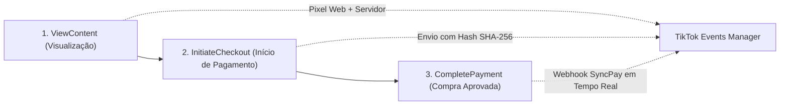

# Manual de Integração: TikTok Events API (Server-Side) & Pixel Web

Este documento detalha a implementação híbrida (Navegador + Servidor) da **API de Eventos do TikTok** para a campanha oficial do **Smart Pet Dogbot**, garantindo o maior índice de qualidade de dados (Event Quality Score - EQS) e rastreamento preciso de conversões no TikTok Ads.

---

## 1. Dados de Acesso Configurados

* **ID do Pixel do TikTok:** `DBMJV8JC77UFMFQAB2G0`
* **Token de Acesso da API de Eventos:** `a7d1c7845083ce990b4f4de74ffe0513c1263cb5`
* **Endpoint Oficial da API TikTok:** `https://business-api.tiktok.com/open_api/v1.3/event/track/`

---

## 2. Eventos Rastreados no Funil de Vendas

Seguindo as melhores práticas do TikTok Ads, foram configurados os **3 eventos principais**:



### 1. `ViewContent` (Visualização da Oferta)
* **Quando é disparado:** Assim que o visitante acessa a landing page do Smart Pet Dogbot.
* **Carga de Dados:**
  * `currency`: `BRL`
  * `value`: `99.90`
  * `content_id`: `smartpet-dogbot-99`
  * `content_name`: `Cachorro Robô Inteligente Smart Pet Dogbot`

### 2. `InitiateCheckout` (Início de Finalização de Compra)
* **Quando é disparado:** Quando o cliente preenche seus dados de entrega e clica em **"GERAR PIX DE R$ 99,90"**.
* **Carga de Dados (Server-Side com Hash SHA-256):**
  * Telefone do cliente (formato E.164 com DDI +55 criptografado em SHA-256).
  * E-mail do cliente criptografado em SHA-256.
  * IP do cliente e User-Agent para correspondência de usuário.
  * `value`: `99.90` | `currency`: `BRL`.

### 3. `CompletePayment` (Pagamento Pix Confirmado)
* **Quando é disparado:** Disparado de **servidor para servidor (Server-to-Server)** assim que o **Webhook da SyncPay** recebe a notificação de status `paid` do banco, além do disparo no navegador quando a tela de Código de Rastreio é aberta.
* **Garantia de 100% de Atribuição:** Mesmo se o cliente fechar o navegador antes de voltar à loja, o backend Node.js avisa o TikTok na hora!

---

## 3. Estrutura dos Arquivos no Projeto

* **[`server/services/tiktok.service.js`](file:///c:/Users/Pichau/Desktop/Ofertas/server/services/tiktok.service.js):**  
  Serviço Node.js responsável por sanitizar e aplicar hash SHA-256 no telefone/email e enviar requisições `POST` seguras para a API de Eventos do TikTok.
* **[`server/server.js`](file:///c:/Users/Pichau/Desktop/Ofertas/server/server.js):**  
  Integração automática nos endpoints `/api/payment/pix` (`InitiateCheckout`), `/api/webhook/syncpay` (`CompletePayment`) e `/api/events/tiktok`.
* **[`server/test-tiktok.js`](file:///c:/Users/Pichau/Desktop/Ofertas/server/test-tiktok.js):**  
  Script de teste automatizado para validar o envio de eventos e checar a resposta do servidor do TikTok.
* **[`index.html`](file:///c:/Users/Pichau/Desktop/Ofertas/index.html) e [`Page exemplo oferta .html`](file:///c:/Users/Pichau/Desktop/Ofertas/Page%20exemplo%20oferta%20.html):**  
  Código base do Pixel do TikTok no `<head>` e disparos de eventos de navegador.

---

## 4. Variáveis de Ambiente Necessárias na Render

Para que os eventos de servidor continuem sendo enviados em produção na Render, adicione as variáveis na aba **Environment**:

| Chave (Key) | Valor (Value) |
| :--- | :--- |
| **`TIKTOK_PIXEL_ID`** | `DBMJV8JC77UFMFQAB2G0` |
| **`TIKTOK_ACCESS_TOKEN`** | `a7d1c7845083ce990b4f4de74ffe0513c1263cb5` |

---

## 5. Como Testar e Acompanhar os Eventos no TikTok

1. No terminal local ou servidor, execute:
   ```bash
   node server/test-tiktok.js
   ```
2. Retorno esperado: `{"code": 0, "message": "OK"}`.
3. No [TikTok Ads Manager](https://ads.tiktok.com/), acesse **Ferramentas > Eventos > Web Events (Pixel DBMJV8JC77UFMFQAB2G0)** e clique na aba **"Eventos de Teste"** ou **"Visão Geral"** para ver os eventos em tempo real!
